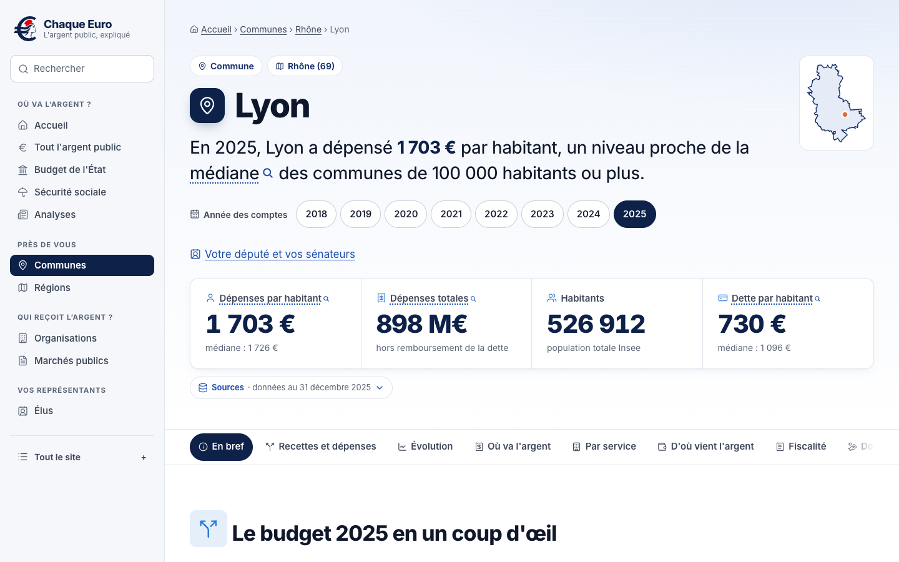
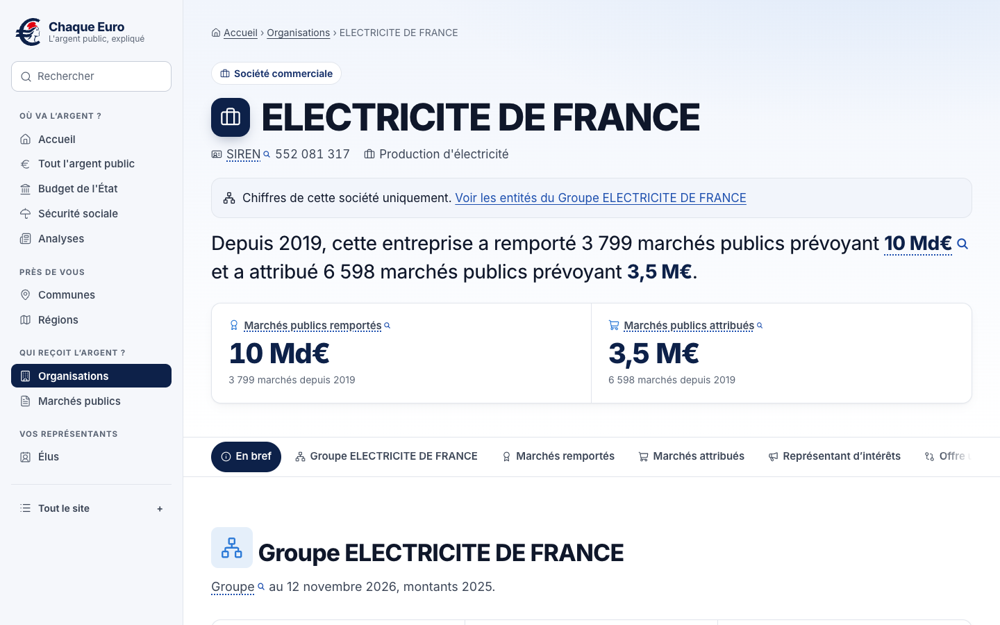

# Chaque Euro

**Où va l'argent public, avec la source de chaque chiffre.**

[chaqueeuro.fr](https://chaqueeuro.fr) · [MCP pour les assistants IA](https://chaqueeuro.fr/ia) · [Télécharger les données](https://chaqueeuro.fr/telechargements) · [Méthode et sources](https://chaqueeuro.fr/methodologie)


Chaque Euro est un site indépendant et non partisan qui transforme les données publiques officielles en réponses simples. Combien d'argent public cette entreprise ou cette association a-t-elle reçu ? Comment ma commune dépense-t-elle, comparée aux communes de même taille ? Où va le budget de l'État ? Qui me représente, et comment vote-t-il ?

Chaque chiffre renvoie au fichier de son producteur et au code de ce dépôt qui l'a calculé.

## Ce que vous y trouvez

| Rubrique | Contenu |
|---|---|
| [Organisations](https://chaqueeuro.fr/organisations) | Marchés publics remportés et attribués depuis 2019, subventions de l'État, lobbying et groupes, pour environ 210 000 entreprises, associations et organismes publics |
| [Communes](https://chaqueeuro.fr/communes) | Dépenses, recettes, dette et impôts locaux par habitant sur 8 ans pour chaque commune (environ 35 000), comparés à la médiane des communes de même taille et cartographiés par département |
| [Argent public](https://chaqueeuro.fr/argent-public) | Budget de l'État, Sécurité sociale, opérateurs de l'État et collectivités locales, des comptes nationaux jusqu'à chaque programme |
| [Élus](https://chaqueeuro.fr/elus) | Votre député et vos sénateurs à partir de votre adresse, leurs votes, leurs déclarations d'intérêts, les comptes de campagne et le financement des partis |
| [Marchés publics](https://chaqueeuro.fr/marches-publics), [lobbying](https://chaqueeuro.fr/lobbying), [lois](https://chaqueeuro.fr/documents/dossiers) | Tendances des marchés publics, registres du lobbying, Journal officiel, dossiers législatifs et administrations |
| [Analyses](https://chaqueeuro.fr/analyses) | Courtes études : le déficit président par président, ce que la France verse à l'Europe et ce qu'elle en reçoit, pourquoi Paris dépense plus, le coût du rail, les étudiants |

<p>
  
  
</p>

## Principes

- **Chaque chiffre est sourcé.** « Voir la source » ouvre la page, le fichier ou l'enregistrement du producteur. « Voir le calcul » ouvre le fichier SQL ou Python de ce dépôt qui a produit le chiffre.
- **Uniquement les producteurs d'origine.** Plus de 110 sources issues de 55 producteurs, dont les ministères, l'Insee, la DGFiP, l'OFGL, la HATVP, la CNCCFP, l'Assemblée nationale, le Sénat, la DILA et la Commission européenne. Chaque source affiche la date de ses données. Rien ne vient d'un autre agrégateur.
- **Neutre.** Les chiffres sont présentés tels que publiés, à côté de repères justes comme les communes de même taille ou les années précédentes. Pas de note, pas d'accusation.
- **Vie privée.** Les entrepreneurs individuels et les unités non diffusibles ne sont jamais nommés. Les élus n'apparaissent que dans leur rôle public. Aucun cookie, seulement des statistiques d'audience agrégées.

## Serveur MCP pour les assistants IA

Le serveur MCP en lecture seule `https://chaqueeuro.fr/mcp` donne à Claude, ChatGPT, Le Chat, Codex et aux autres assistants les mêmes données que le site, avec leurs sources. Aucun compte n'est nécessaire.

- **Claude** (offre gratuite comprise) : dans les connecteurs, ajoutez un connecteur personnalisé avec cette adresse, sans connexion.
- **Claude Code** : `claude mcp add --transport http chaque-euro https://chaqueeuro.fr/mcp`
- **Codex** : `codex mcp add chaque-euro --url https://chaqueeuro.fr/mcp`
- **Autres** : ajoutez un serveur MCP distant (Streamable HTTP) avec la même adresse. Les instructions pour ChatGPT, Le Chat, Gemini CLI, Cursor, VS Code et Windsurf sont sur [chaqueeuro.fr/ia](https://chaqueeuro.fr/ia).

Ses 33 outils reprennent les pages du site et sont définis dans [`site/src/lib/mcp.ts`](site/src/lib/mcp.ts).

## Données ouvertes

Toutes les tables calculées sont sur [/telechargements](https://chaqueeuro.fr/telechargements), en CSV et en Parquet, sous Licence Ouverte 2.0. [`/methodologie/manifest.json`](https://chaqueeuro.fr/methodologie/manifest.json) indique, pour chaque source, les adresses exactes téléchargées, leur date, la période couverte, le nombre de lignes et l'empreinte SHA-256 de chaque fichier.

## Fonctionnement

```
pipeline/sources.toml → téléchargement avec empreintes SHA-256 → SQL DuckDB → SQLite, CSV, Parquet, manifeste → site Astro et serveur MCP
```

| Chemin | Contenu |
|---|---|
| `pipeline/sources.toml` | Le registre des sources, seul endroit où figure l'adresse d'un jeu de données |
| `pipeline/src/chaque_euro/` | Ligne de commande, téléchargement, construction et export |
| `pipeline/sql/` | Transformations DuckDB, une par fichier, liées depuis le site par « Voir le calcul » |
| `pipeline/schema.sql` | Le schéma SQLite |
| `site/` | Le site Astro pour l'environnement Cloudflare Workers, avec une base D1 |
| `site/src/lib/data.ts` | L'unique module d'accès aux données, partagé par toutes les pages et le serveur MCP |
| `docs/datasets.md` | L'inventaire des jeux de données et les raisons des choix |

Les pages sont produites à la demande, avec au plus deux allers-retours vers la base chacune, puis mises en cache. La recherche utilise SQLite FTS5. Les données sont mises à jour chaque nuit, et une nouvelle version n'est publiée que si elle passe des contrôles d'intégrité et de nombre de lignes.

## Lancer le projet en local

Il faut [uv](https://docs.astral.sh/uv/), `pdftotext` de Poppler (`brew install poppler`) et Node 24.

Construire les données :

```sh
cd pipeline
uv sync
uv run chaque-euro run
```

Cette commande télécharge chaque source dans `data/raw/<source>/` (mis en cache ; `--refresh` pour retélécharger), exécute `pipeline/sql/*.sql` dans DuckDB et écrit dans `data/build/` : la base SQLite, les téléchargements CSV et Parquet, les fichiers d'import D1 et `manifest.json`. `uv run chaque-euro fetch --only decp` télécharge une seule source. Les comptes des communes de l'OFGL prennent environ 13 minutes, car leur API est parcourue par département et par année.

Lancer le site :

```sh
cd site
npm install
npm run db:seed:local
npm run build
npx wrangler dev --persist-to .wrangler/state   # http://localhost:8787
```

Vérifications :

```sh
cd site && npm run check && npm run lint && npm run format:check && npm test
cd pipeline && uv run ruff format --check . && uv run ruff check . && uv run mypy src
```

## Corrections et contributions

Un chiffre vous semble faux ? Écrivez à contact@polastra.com (voir [Demander une correction](https://chaqueeuro.fr/mentions-legales#correction)) ou ouvrez une issue. Si l'erreur vient de la source officielle, signalez-la aussi à son producteur.

Les pull requests sont bienvenues. Les conventions du dépôt sont dans [AGENTS.md](AGENTS.md).

## Licence

Code : [GNU AGPL-3.0](LICENSE), copyright 2026 Arthur Verrez.

Données calculées : [Licence Ouverte 2.0](https://www.data.gouv.fr/pages/legal/licences/etalab-2-0). Citez Chaque Euro avec un lien. Chaque source garde sa propre licence, indiquée sur [/methodologie](https://chaqueeuro.fr/methodologie).
